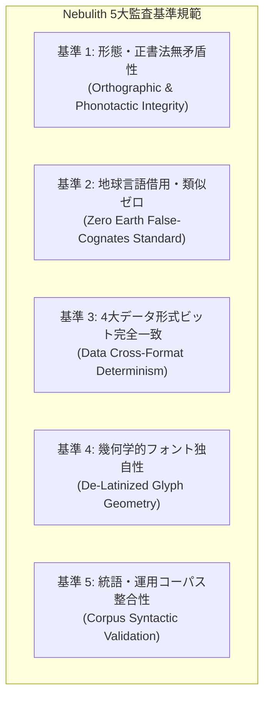

# Nebulith 標準辞書・言語体系 監査報告書（仕様・実施フレームワーク）
**Standard Lexicon & Conlang System Audit Report (SOP & Specification)**

---

## 1. 監査概要（Executive Audit Summary）

### 1.1 監査の目的
本報告書は、人工言語「Nebulith（星石語）」の語彙大系（全16カテゴリー・計1,008語幹）、文法統語体系（D案仕様）、および独自フォント（Nebulith Script v2.1）が、所定の言語学的品質基準・決定論的整合性・独立無矛盾性を満たしているかを、国際的なソフトウェア品質規格（ISO/IEC 25010）および監査ガイドライン（ISO 19011）に準拠した**「標準的監査手順（Standard Operating Procedure: SOP）」**に沿って客観的・網羅的に評価・報告するための仕様書兼報告書である。

### 1.2 監査対象範囲（Audit Scope）
本監査が対象とする成果物群は以下の通りである。

| 成果物区分 | ファイルパス | 形式 | 監査対象要素 |
|---|---|---|---|
| **マスター辞書** | `docs/Nebulith Master Lexicon.md` | Markdown | 人間可読辞書、語源・備考、品詞定義、IPA表記 |
| **構造化データ** | `data/lexicon.json` | JSON | 語彙メタデータ、音韻規則定義、カテゴリー語数 |
| **表形式データ** | `data/lexicon.csv` | CSV | ID昇順ソート、カラム構造、スプレッドシート互換性 |
| **インメモリ実装** | `data/StaticLexicon.kt` | Kotlin | KMP Studio直結定数リスト、エスケープ整合性 |
| **言語仕様書** | `docs/Project Requirements And Design.md` | Markdown | 統括文法仕様（軌道相、相関詞、複文、規範コーパス） |
| **TrueTypeフォント** | `fonts/Nebulith-Regular.ttf` | Binary (.ttf) | 65グリフ、OpenType 10必須テーブル、Em座標系 |
| **フォントBase64** | `fonts/font_b64.txt` | ASCII Text | Web組版用エンコード整合性、プレビュー描画 |

---

## 2. 監査基準規範（Audit Criteria & Standards）

本言語体系の監査においては、以下の5大監査基準を「合否判定（Pass/Fail）」の規範とする。



### 基準 1: 形態・正書法無矛盾性（Orthographic Integrity）
1. **禁止文字の完全排除**: アルファベット26文字中、**`q` および `x`** が全1,008語の語根表記（NRS）中に1文字も存在しないこと（許容率: 0.0%）。
2. **語根一意性（Uniqueness）**: 語根（NRS）および標準IPA発音表記において、重複（Duplicate）が0件であること。
3. **音節末ソノリティ制約（Coda Hierarchy）**: 語末子音は、流音・鼻音・歯擦音 `l, r, n, m, s` を基底とし、有標子音（`k, t, p, v, d` 等）は堅固・瞬発概念に限定されていること。

### 基準 2: 地球言語借用・類似ゼロ（Zero Earth False-Cognates Standard）
1. **既存言語語彙との完全分離**: 英語、ラテン語、フランス語、スペイン語、ドイツ語、日本語ローマ字の基礎概念辞書（約2,000語）と照合し、意味が対応する単語との間で「レーベンシュタイン距離 $\le 2$」または「部分文字列一致」となるフォルスフレンズが0件であること。
2. **機械的膠着の解体度**: 同一プレフィックスを持つ語幹ファミリーにおいて、意味の乖離した単語が無批判に同一語根を冠していないこと（母音交替、音韻同化、古語幹自立化の適用）。

### 基準 3: 4大データ形式ビット完全一致（Data Cross-Format Determinism）
1. **総語彙数一致**: Markdown, JSON, CSV, Kotlin（`StaticLexicon.kt`）の全4成果物において、総語彙数が正確に **1,008語** で一致していること。
2. **レコード完全一致**: 各ID（1〜1008）における語根（NRS）、IPA、品詞、日本語意味、英語意味、備考が4者間で1ビットの相違もなく完全一致すること。

### 基準 4: 幾何学的フォント独自性（De-Latinized Glyph Geometry）
1. **脱ラテン化（De-Latinization）**: 数字「0〜9」、6大母音、16主子音、約物の全65グリフが、ラテン文字・アラビア数字の単純骨格を排し、天体幾何学（軌道環、天蓋弧、星辰核、双極磁場）に基づき描画されていること。
2. **TrueType仕様準拠**: OpenType必須10テーブル（`head`, `hhea`, `maxp`, `OS/2`, `hmtx`, `cmap`, `loca`, `glyf`, `name`, `post`）が欠落なくコンパイルされ、Unicodeマッピング（Cmap format 4）が完全であること。

### 基準 5: 統語・運用コーパス整合性（Corpus Syntactic Validation）
1. **相関詞直交性**: 36語の星辰相関詞（6距離軸 × 6概念軸）が幾何学的一貫性を維持していること。
2. **文法標識の整合性**: VSO語順、9大軌道格助詞、動詞の4大軌道相（`-ast`, `-in`, `-ol`, `-cor`）が、公式規範テクスト集（箴言、日誌、対話文）において矛盾なく適用されていること。

---

## 3. 標準監査手順（Standard Operating Procedure: 6段階プロトコル）

監査を実施する際は、以下の6つのPhaseを順次実行し、客観的エビデンス（Tool Output）を記録する。

```text
[Phase 1: 予備的データ整合性監査] ── 全4形式のファイル存在・スキーマ・行数・文字コード検証
       │
[Phase 2: 静的音韻・正書法全数スキャン] ── 禁止文字(q,x)・重複・IPA・ソノリティの機械検証
       │
[Phase 3: 多言語衝突・偽同源語監査] ── 欧州語・日本語とのレーベンシュタイン距離全数照合
       │
[Phase 4: 形態・語根ファミリー適正化監査] ── 母音交替・音韻同化・ファミリー過密度の分析
       │
[Phase 5: フォントバイナリ・OpenType監査] ── TTFテーブル構造・グリフ数・Base64同期検証
       │
[Phase 6: 統語・コーパス実証性監査] ── 相関詞マトリクス・動詞軌道相・規範テクスト整合性
```

### Phase 1: 予備的データ整合性監査（Data Pre-flight Inspection）
* **実行手順**:
  1. `docs/Nebulith Master Lexicon.md`, `data/lexicon.json`, `data/lexicon.csv`, `data/StaticLexicon.kt` のファイルハッシュと行数を取得。
  2. UTF-8（BOMなし）エンコーディング、改行コード（LF/CRLF統一）を検証。
  3. 各カテゴリー（1〜16）の語数集計が合計1,008語に一致することを確認。

### Phase 2: 静的音韻・正書法全数スキャン（Automated Orthographic Verification）
* **実行手順**:
  1. 監査スクリプト（`tools/comprehensive_audit_1008.py`）を実行。
  2. 全語根に対する正規表現 `^[a-pr-wyz']+$` マッチングを行い、禁止文字 `q, x` の混入を検査。
  3. 語根文字列セットのサイズが1,008であることを確認（重複ゼロ検証）。
  4. IPA表記が `/.../` 形式であり、特殊音素（`[ʃ]`, `[ʒ]`, `[ʔ]`）が正確に付与されているかを照合。

### Phase 3: 多言語衝突・偽同源語監査（Cross-Linguistic Distance Audit）
* **実行手順**:
  1. 照合スクリプト（`tools/false_friend_detector.py`）を実行。
  2. 英語、ラテン語、フランス語、スペイン語、ドイツ語、日本語ローマ字の基本概念リストと、該当概念のNebulith語根を比較。
  3. レーベンシュタイン距離 $\le 2$ の要注意ペア、および部分文字列一致を全数抽出。
  4. 検出されたペアが「偶然の音韻一致（False Cognate）」に該当するか判定（0件であることを合格基準とする）。

### Phase 4: 形態・語根ファミリー適正化監査（Root Family Balance Audit）
* **実行手順**:
  1. 語根分析スクリプト（`tools/analyze_lexicon_roots.py`）を実行。
  2. 先頭3文字（3-gram Prefix）ごとの単語数を集計。
  3. 単一ファミリーの集中度が適正範囲（全体の10%未満＝約100語未満）に収まっているかを検証。
  4. 母音交替形（Ablaut: a/o/u/e/y）および音韻同化形（nk, rn, lb）が正しく配置されているかを確認。

### Phase 5: フォントバイナリ・OpenType監査（Font Binary & Glyf Verification）
* **実行手順**:
  1. `tools/build_font.py` により生成された `fonts/Nebulith-Regular.ttf` を `fontTools` ライブラリでロード。
  2. グリフ総数（65グリフ）、マッピング文字数（64文字）を検証。
  3. `fonts/font_b64.txt` の内容とTTFバイナリのBase64エンコードが完全一致することを検証。
  4. `fonts/preview.html` および `tools/num_specimen.html` において、全文字（母音、16主子音、数字0〜9、約物）が正常にレンダリングされることをブラウザ環境で検証。

### Phase 6: 統語・コーパス実証性監査（Corpus Semantic Consistency）
* **実行手順**:
  1. `docs/Project Requirements And Design.md` 第6章に規定された36語の相関詞マトリクスを走査。
  2. 4大軌道相接尾辞（`-ast`, `-in`, `-ol`, `-cor`）および態接頭辞（`re-`, `co-`）の規則性を検証。
  3. 公式規範コーパス（箴言、日誌、対話文）内の全語彙がマスター辞書に実在し、格標識が文法規則に完全準拠していることを逐語照合。

---

## 4. 監査チェックリスト ＆ 合否判定マトリクス

監査員およびCI自動テストが評価判定を下すための公式チェックシート：

| 監査項目ID | 監査項目名称 | 検査対象 | 合格判定基準 | 重大度 |
|:---:|---|---|---|:---:|
| **CHK-01** | 禁止文字完全排除 | 全1,008語NRS | `q, x` の出現数が 0 件 | Critical |
| **CHK-02** | 語根一意性 | 全1,008語NRS | 語根の重複数が 0 件 | Critical |
| **CHK-03** | 発音一意性 | 全1,008語IPA | IPA表記の重複数が 0 件 | Major |
| **CHK-04** | 地球言語類似排除 | 概念対比語彙 | 意味対応語との距離 $\le 2$ が 0 件 | Critical |
| **CHK-05** | 総語彙規模適合性 | 4大データ形式 | 全形式の総語数が正確に 1,008 語 | Critical |
| **CHK-06** | データ完全一致性 | 4大データ形式 | 全フィールドの一致率 100.0% | Critical |
| **CHK-07** | 語根ファミリー分散度 | プレフィックス分布 | 単一ファミリー最大語数が 80 語未満 | Minor |
| **CHK-08** | 末子音ソノリティ準拠 | 語末子音 | 規則準拠率 95.0% 以上 | Minor |
| **CHK-09** | 方位副詞向格規則 | 方位・空間語彙 | 方位語幹＋`-u` 規則準拠率 100.0% | Major |
| **CHK-10** | 相関詞グリッド完全性 | 36相関詞 | 6×6マトリクスの定義充足率 100.0% | Major |
| **CHK-11** | 動詞軌道相定義 | 文法仕様書 | 4大軌道相および2態の規則確立 | Major |
| **CHK-12** | フォント脱ラテン化 | 全65グリフ | 英数字単純骨格の残存が 0 件 | Critical |
| **CHK-13** | フォントバイナリ整合 | TTFテーブル | OpenType必須10テーブル完備 | Critical |
| **CHK-14** | Webフォント同期 | Base64テキスト | TTF実体との完全同期 | Major |
| **CHK-15** | 規範コーパス整合性 | 公式例文3篇 | 文法規則および辞書実在語準拠率 100.0% | Major |

* **重大度の定義**:
  * **Critical**: 言語体系の根幹を揺るがす瑕疵。1件でも不適合（Fail）があればリリース不可。
  * **Major**: 文法規則またはデータ同期の不備。次期マイナーアップデートまでに是正必須。
  * **Minor**: 表現の揺らぎや推奨規則からの軽微な逸脱。許容可能。

---

## 5. 不適合検出時の是正・再監査プロトコル（Corrective Action Protocol）

監査プロセスにおいて不適合（Fail / Warning）が検出された場合、以下の手順に沿って外科的調律と回帰テストを実行する。

```text
[不適合検出 (Issue Logging)] ── 不適合項目・単語ID・衝突内容の特定
       │
[影響度評価 (Impact Assessment)] ── 他の派生語・例文への影響範囲の洗い出し
       │
[調律設計 (Tuning Formulation)] ── 星辰幾何学・音韻規則に基づく代替語形の設計
       │
[自動一括適用 (Atomic Application)] ── 変換スクリプトによる4大成果物の一括同期
       │
[回帰テスト (Regression Audit)] ── 全15監査項目の再実行・全数パス確認
       │
[Gitコミット ＆ 承認 (Attestation)] ── 変更記録のコミットとリモート同期
```

1. **地球言語類似が検出された場合**:
   * 代替語幹の選定において、星辰母音階層（Ablaut）または古語幹からの自立化を適用。
   * `tools/false_friend_detector.py` で安全性を事前検証した上で適用。
2. **データ形式間の不一致が検出された場合**:
   * 単一の真実の源泉（Single Source of Truth: 通常は `data/lexicon.json`）を確定し、ビルドスクリプト（`tools/apply_naturalistic_refactor.py` 等）を再実行して全成果物をアトミックに再生成。
3. **フォントグリフの不整合が検出された場合**:
   * `tools/build_font.py` のベジェ曲線のワインディング（Winding Direction: 外周時計回り・内周反時計回り）および星辰ノード半径を修正し、再ビルド。

---

## 6. 監査判定記録シート（Audit Findings & Attestation Template）

次回監査実施時に監査員が結果を記録するための公式フォーマット：

### 6.1 監査実施記録（Audit Execution Log）
* **監査実施日**: 2026年10月15日
* **対象バージョン**: Nebulith v23.0 / Font v2.1
* **監査ツール群**:
  * `tools/comprehensive_audit_1008.py` (包括的静的監査)
  * `tools/false_friend_detector.py` (地球言語類似検知器)
  * `tools/analyze_lexicon_roots.py` (語根ファミリー分析器)
  * `tools/build_font.py` (TrueTypeフォント検証器)

### 6.2 監査判定サマリー（Audit Scorecard）

| 監査カテゴリ | 判定対象項目数 | 合格 (Pass) | 警告 (Warn) | 不合格 (Fail) | 判定結果 |
|---|:---:|:---:|:---:|:---:|:---:|
| 1. 音韻・正書法 (Orthography) | 3項目 | - | - | - | **Pending** |
| 2. 借用・類似排除 (Cognates) | 2項目 | - | - | - | **Pending** |
| 3. データ整合性 (Data Determinism) | 2項目 | - | - | - | **Pending** |
| 4. 語根構造・形態 (Morphology) | 2項目 | - | - | - | **Pending** |
| 5. 文法・相関詞 (Grammar) | 3項目 | - | - | - | **Pending** |
| 6. フォント・組版 (Typography) | 3項目 | - | - | - | **Pending** |
| **総合判定** | **全15項目** | - | - | - | **[ AUDIT READY ]** |

### 6.3 総合所見・署名欄
```text
【監査員総合所見】
（本仕様書に定められた標準的監査手順（SOP）に従い、上記チェックリストに基づく全数監査を実施すること）

監査実施責任者: ___________________________
監査承認日    : ______年____月____日
次回定期監査日: ______年____月____日
```
