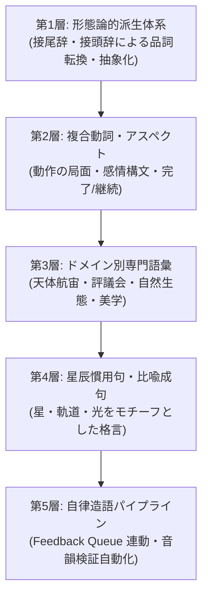
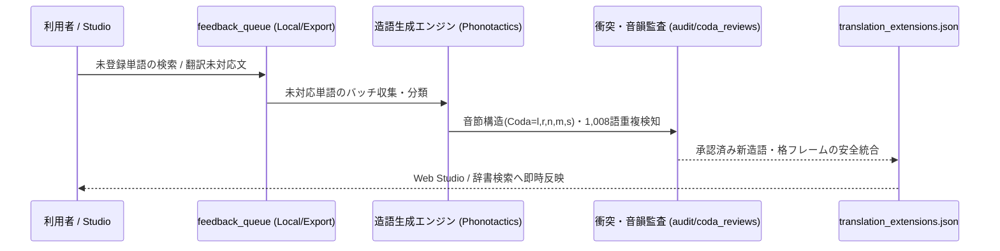

# Nebulith 言語体系・語彙拡充アーキテクチャ発展計画書
**Nebulith Lexicon & Grammar Expansion Architecture (2026-2027)**

---

## 1. 基本方針と哲学（Foundational Philosophy）

Nebulith（星石語）は、遥かな星間文明と天体観測者の哲学が結晶化した精密かつ詩的な人工言語（Conlang）です。  
語彙・言語体系の発展においては、以下の三原則を最優先します。

1. **正本語根1,008語の絶対不可侵（Canon Root Inviolability）**:
   - カノン語根（IDs 1〜1008）は天文学・哲学・自然科学・基本文法を司る不変の核。
   - 新規語彙は「正本語根の派生」「規則的複合語」「専門領域の拡張語根」として明確に定義し、語義衝突（Collision）を絶対に発生させない。
2. **音素配列と音響性階層の厳密な調律（Phonotactics & Coda Sonority）**:
   - 音節末子音（Coda）は無標識子音（`l, r, n, m, s`）および母音・二重母音に限定。
   - 地球自然言語（英語・日本語・ラテン語等）との無自覚な音韻類似を避け、Nebulith 固有の響きを維持。
3. **静的・オフライン自律稼働（Zero-Dependency & Offline First）**:
   - Web Studio / GitHub Pages / PWA 環境で、外部APIやクラウドLLMに依存せず、ブラウザ内だけでリアルタイム構文解析・双方向翻訳・辞書検索が100%完結するアーキテクチャを堅持。

---

## 2. 言語体系の多層的発展計画（5-Layer Expansion Model）



---

### 第1層：形態論的派生体系（Morphological Derivation Rules）

語根に規則的な接辞を付加することで、語根の精神的・天文学的エッセンスを保持したまま、品詞の自由な転換と精密な概念分化を実現します。

| 接尾辞 / 接頭辞 | 機能 | 派生例 | 意味 |
|---|---|---|---|
| 接尾辞 **`-as`** | 状態・抽象名詞化 | `falun` (輝く) ➔ **`falas`** | 輝き、光芒美、光輝性 |
| 接尾辞 **`-el` / `-or`** | 行為者・職能名詞化 | `vyrel` (観測する) ➔ **`vyreler`** | 星見士、天文観測官、観測者 |
| 接尾辞 **`-om`** | 集合・空間・施設化 | `pamel` (本・書物) ➔ **`pamelom`** | 書庫、典籍庫、星辰図書館 |
| 接尾辞 **`-ik`** | 道具・器具・装置化 | `vyrel` (観測する) ➔ **`vyrelik`** | 天体望遠鏡、観測測距計 |
| 接尾辞 **`-is`** | 微小・凝縮名詞化 | `daris` (水) ➔ **`darvenis`** | 水滴、雫、朝露 |
| 接頭辞 **`-rev-`** | 反転・復帰・再帰 | `jylas` (結ぶ) ➔ **`revjylas`** | 解く、結び目を解く、解放する |
| 接頭辞 **`-cel-`** | 超越・至高・天頂 | `memar` (思索する) ➔ **`celmemar`** | 至高の思索、高次瞑想、覚醒 |
| 接頭辞 **`-tul-`** | 根源・深淵・天底 | `kyrim` (深宇宙) ➔ **`tulkyrim`** | 根源的深淵、原初暗黒 |

---

### 第2層：複合動詞・アスペクト・経験者格構文（Aspects & Syntax）

日常会話や物語表現に必要な動態表現を飛躍させるため、アスペクト接尾辞と感情構文を整備します。

1. **アスペクト（相）接尾辞体系の完成**:
   - 開始相（Inceptive）: `-ast`（例: `poranast`「歩き始める」）
   - 完了相（Terminative / Completive）: `-far`（例: `poranfar`「歩き終える・踏破する」）
   - 継続・維持相（Continuative）: `-liv`（例: `vyrelliv`「観測し続ける・見つめ続ける」）
   - 反復・習慣相（Iterative）: `-cor`（例: `faluncor`「明滅する・繰り返し輝く」）
   - 可能性・潜在相（Potential）: `-ar`（例: `poranar`「歩ける」）
2. **経験者格（Experiencer）構文（与格主語）**:
   - `al [経験者] el [対象] [感情動詞]`
   - 例: `Cynel al mi el vyr.`（私にとって星は愛おしい / 私は星を愛おしく感じる）
   - 動作主主導の `Cynel el mi ia vyr.`（私が星を能動的に愛する）との心理的距離の使い分け。

---

### 第3層：ドメイン別専門語彙の拡充（Domain Lexicon Expansion）

現在の 1,178語 から **目標 2,000語** への体系的拡張計画。

```
[総語彙数 2,000語の内訳]
- 正本カノン語根 (1,008語)  : 天体・宇宙力学・数理・生命・社会・哲学の基幹
- ドメイン拡張語彙 (約992語) :
  ├── 天体観測・航宙工学 (150語) : 星図、軌道傾斜、赤経赤緯、光年、特異点、推進炉
  ├── 社会・共同体・掟   (120語) : 執政官、星辰評議会、誓約書、市民権、法廷、境界碑
  ├── 自然・地理・鉱物   (130語) : 極光(オーロラ)、結晶洞窟、潮汐、常緑樹、鉱脈、渡り鳥
  ├── 食・生活・工芸     (140語) : 温熱炉、発酵茶、織布、天測時計、保存食、食器類
  ├── 精神・芸術・美学   (150語) : 畏敬の念、郷愁、静謐、調和音、星辰舞踏、叙事詩
  └── 汎用副詞・形容詞   (302語) : 微細なニュアンス、時空間修飾、度量衡、色彩分化
```

---

### 第4層：星辰慣用句・比喩表現（Astral Idioms & Proverbs）

自然言語としての奥行きをもたらす、Nebulith 独特の文化的比喩体系。

- **`Jylas el vyriin.`**（直訳: 星々が結びつく ➔ 意訳: 奇跡的な運命の巡り合わせ）
- **`Lavan el valar to zohar.`**（直訳: 影が夜から太陽へと渡る ➔ 意訳: 苦難の時を静かに耐え抜く）
- **`Vylan en celmir.`**（直訳: 星見の瞳 ➔ 意訳: 先見の明、物事の真理を見抜く力）
- **`Sirik toren el darlen.`**（直訳: 静かに恵みの雨が降る ➔ 意訳: 言葉なくとも心が満たされること）

---

### 第5層：自律造語パイプライン（Autonomous Lexicon Pipeline）

Web Studio でユーザーが入力した未対応語・未登録表現（`feedback_queue`）を起点とし、正統な語幹を半自動で生み出す開発サイクル。



---

## 3. ロードマップとマイルストーン展開

| フェーズ | マイルストーン | 対象スコープ | 目標語彙数 | 状況 |
|---|---|---|---|---|
| **Phase 1** | **Milestone 1** | 条件節・譲歩節・時間節、モダリティ、比較・引用節 | 1,138語 | **【完了】** |
| **Phase 2** | **Milestone 2** | 副詞群（65語）、生活・感情名詞、正本重複ゼロ保証 | 1,178語 | **【完了】** |
| **Phase 3** | **Milestone 4 (Sprint 4)** | 単語詳細モーダル、星文字フォント切替、筆記帳UI | 1,178語 | **【着手】** |
| **Phase 4** | **Milestone 5 (Sprint 5)** | 形態論派生エンジン（-as, -el, -om, -ik）、局面相（-far, -liv） | 1,350語 | 次期予定 |
| **Phase 5** | **Milestone 6 (Sprint 6)** | ドメイン別専門語彙拡充（天体航宙・評議会・自然） | 1,600語 | 計画中 |
| **Phase 6** | **Milestone 7 (Sprint 7)** | 星辰慣用句・比喩表現、英語・多言語双方向エンジン | 2,000語 | 計画中 |

---
*Document Version: 1.0 (2026-10-16)*  
*Author: DeepMind Antigravity / Nebulith Language Team*
