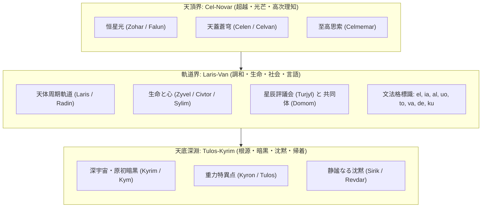

# Nebulith 文明史・星辰世界観大系書
**The Astral Lore and Civilization of Nebulith**

> **言語名**: 星石語（Nebulith / ネブリスク）  
> **話者文明**: 星辰観測文明「星の民（Vyreliin）」  
> **主恒星系**: エテルナ・シリス恒星系（連星系・重力平衡天球）  
> **文書種別**: 公式世界観・文明史・天文学的背景体系書 (Version 1.0)

---

## 1. 文明の起源：天蓋を見上げる民（The Dawn of Vyreliin）

遥かな昔、分厚い星間星雲（`kyrven`）の彼方から大天球（`celvan`）の青き散乱光（`celzyl`）を抜けて定住した民は、自らを「**Vyreliin（星々の観測者たち / 星の民）**」と呼びました。

彼らの母なる地表は、天を仰げば無数の主恒星（`zohar`）と巡礼惑星（`doran`）が織りなす壮大な重力舞踏が昼夜を問わず可視化される、類まれなる観測天球でした。  
大地（`tal`）を踏みしめ、清らかな大河（`darven`）と深き樹林帯（`seldor`）に囲まれながらも、彼らの知性と信仰、法規範、そして芸術のすべては「**天球を巡る星光の軌跡（`laris`）**」から導き出されました。

地球の歴史のように地上資源の争奪から言語が発展したのではなく、**「天球の運行をいかに誤りなく記述し、星々の光と調和して生きるか」**という天文学的・幾何学的要請から生まれた言語、それが **Nebulith（星石語）** です。

---

## 2. 天球三界宇宙論（The Tripartite Cosmos）

Nebulith の世界観および語彙体系は、三つの階層的宇宙領域（三界）によって規定されています。

1. **天頂界（Cel-Novar）**:
   - 最高峰の天頂（`novar`）と大気天蓋（`celen`）。光芒（`falun`）が降り注ぎ、知性と美、真理の直観が宿る領域。
   - 最上級接頭辞 `cel-`（例: `celcylani` 至高の美）はこの領域から由来します。
2. **軌道界（Laris-Van）**:
   - 惑星や連星が巡る周期軌道（`laris`）。調和（`silan`）と共存（`kulen`）、そして日々の生命（`zyvel`）が営まれる場。
   - Nebulith の主語・述語・格助詞の相互関係は、この軌道力学の平衡関係を正確に模しています。
3. **天底深淵（Tulos-Kyrim）**:
   - 天球の最深点（`tulos`）と深宇宙（`kyrim`）。静寂（`sirval`）と休息、星々の終焉（`kylen`）と新たなる光の胎動を秘めた根源の領域。
   - 接頭辞 `tul-`（根源・深淵）はこの領域を象徴します。

---

## 3. 社会構造と職能階層（The Star Councils & Guilds）

Nebulith 文明には専制君主や軍事的支配者は存在せず、天測の正確さと知性の深さに基づく評議会秩序が形成されています。

| 職能・階層 | Nebulith 呼称 | 役割と責務 |
|---|---|---|
| **星見士（観測官）** | **Vyreler** (`vyrel` + `-er`) | 天体望遠儀（`vyrelik`）を用い、星々の軌道傾斜や光度を精密観測し、天辰暦を編纂する。 |
| **光符数理士** | **Sufor** (`suf` + `-or`) | 星辰演算儀（`mator`）を駆使し、軌道計算、光通信網（`tolom`）、幾何学公理の証明を行う。 |
| **星辰評議員** | **Turjylor** (`turjyl` + `-or`) | 掟（`tur`）と誓約（`sen`）に基づき、市民共同体の調和と紛争調停を合議制で司る。 |
| **記録譜士** | **Kiranor** (`kiran` + `-or`) | 星石書庫（`pamelom` / `livar`）にて、歴史・詩歌・観測原典を永久記録板に刻み遺す。 |
| **星石工匠** | **Doloran** (`dolar` + `-an`) | 結晶鉱物や青銅・星石を精錬し、観測儀器・天測時計・生活道具を制作する。 |
| **大地共生者** | **Tarkanin** (`tarkan` + `-in`) | 原生林や河川、耕作地において自然の循環を守り、作物を育む生産階層。 |

---

## 4. 時間と暦法の観念（Astral Chronology & Temporal Philosophy）

地球のような単純な太陽日・太陽年とは異なり、Nebulith 文明の時間は「**重なる周期（`hav`）**」として把握されます。

- **小周期（Tyk-Hav）**: 心臓の脈動（`zyvelan`）と星石時計の規則拍（`tyk`）に基づく短い時間単位。
- **大公転期（Doran-Hav）**: 巡礼惑星が主恒星の周りを一周する期間。
- **恒暗期（Kymhav / 極夜）**: 連星系の一時的な交食によって天空が完全な漆黒に包まれる季節。この時期、人々は篝火（`vorpar`）を灯し、内省（`memar`）と対話（`calun`）、詩歌（`cival`）の朗詠に専念します。
- **時間の方向性**:
  - 過去（`fe`）は「背後へ去った光条」。
  - 未来（`se`）は「これから地平に昇る未踏の光芒」。
  - 現在は「いま交錯する光と視線（`celmir`）」。

---

## 5. 言語の幾何学的哲学（Linguistic Foundations）

なぜ Nebulith はこのような文法構造を持つのか？  
すべては星辰観測者の世界理解に基づいています。

1. **VSO（動詞 ➔ 主語 ➔ 目的語）の必然性**:
   - 「まず光（事象）が宇宙に生じ、次にそれを担う星（主体）が現れ、続いて照らされる大地（対象）が見出される」。動態が主導する宇宙観の反映です。
2. **前置詞による厳格な格定位（Case Markers as Orbital Coordinates）**:
   - `el`（主体・発光体）
   - `ia`（対象・受光体）
   - `al`（帰着点・受容者）
   - `uo`（存在座標・天球上の座）
   - `to`（目的方向・飛翔の先）
   - `va`（起点・比較の基準星）
   - `de`（手段・道具・動作主）
   - `ku`（共鳴者・連星的同伴者）
3. **星石文字（Astral Script）の神聖性**:
   - 星文字は単なる音素記号ではなく、天体軌道・光線角・星辰の結び目を幾何学的に写し取った「シジル（天球紋様）」です。星見士が石版に刻んだ文字が、現在に伝わる美しいフォントの原点となっています。

---
*Nebulith Civilization Archives - Curated by DeepMind Antigravity*
