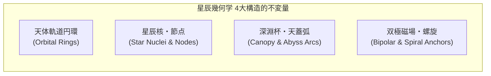

# 人工言語「Nebulith（ネビュリス）」統合スタジオ 要件定義および設計仕様書

**文書バージョン**: v23.4（監査中・個別の未完了項目あり）
**最終更新日**: 2026-10-15
**関連ドキュメント**: `Nebulith Master Lexicon.md`（辞書v23.4・1008項目）
**利用スコープ**: **完全個人専用（シングルユーザー・完全オフライン・サーバー＆外部I/Oゼロ）**
**ターゲット環境**: **Windows 10/11 (JVM Desktop `.exe` / `.msi`)** および **Android 10〜15+ (`.apk`)**

---

## 1. アーキテクチャ基本方針とKMPモジュール構成

### 1.1 オフライン実行と開発時I/Oの区別
アプリ実行時は外部サーバー・同期・外部データベースを使わず、静的バンドルを読み出す。入力はメモリ上に保持し、利用者の明示操作によるクリップボードコピーを提供する。開発時の出典取得・辞書の生成・監査証跡の保存・配布物の作成は、この実行時制約とは区別する。

1. **アプリ内静的辞書バンドル**: 基本語幹、文法機能語、主要派生語・複合語は、Kotlinコード内の不変コレクション（`StaticLexicon`）としてバイナリに直結内包する。
2. **決定論的造語と静的昇格サイクル**: 未登録語はFNV-1aハッシュと新音韻規則で即座に自動生成する。正式採用時はインスペクターで整合性を検証し、Kotlinコード定義（`LexiconEntry`）として出力・ソースコードへコミットしてバイナリへ恒久統合する。
3. **インメモリ直結のAndroid IME**: システムキーボード（`NebulithInputMethodService`）はファイルI/Oを一切介さず、`commonMain` のオンメモリ辞書と変換エンジンを直接参照して高速動作する。

### 1.2 KMP モジュール構造とソースセット設計

以下は将来のKMP/Compose構成案。Windowsの最小PoCはKotlin/JVMで共通検索ロジックとSwing画面を分離し、静的辞書・字体・例文を利用する。Compose/KMPビルド・Android・システムIME・汎用翻訳器はまだ実装していない。

```text
nebulith/
├── build.gradle.kts
├── settings.gradle.kts
└── composeApp/
    ├── build.gradle.kts
    └── src/
        ├── commonMain/kotlin/com/reiun/nebulith/       【全OS共通コア (共有率 95%以上)】
        │   ├── domain/
        │   │   ├── model/         (SyllableToken, WordBlock, LexiconEntry)
        │   │   ├── phonology/     (PhonologyConfig: 6母音+4二重母音+18子音、ソノリティ規則、FNV-1a造語)
        │   │   ├── morphology/    (語形成規則・品詞接辞展開・逆解析ステートマシン)
        │   │   ├── validation/    (LexiconIntegrityValidator: 新音韻・衝突・重複・複合検証)
        │   │   └── syntax/        (日英SOV/SVO ⇔ Nebulith VSO 双方向構文変換器)
        │   ├── data/
        │   │   └── lexicon/       (StaticLexicon: 新体系基本語幹・機能語・焼き込み定数)
        │   ├── font/
        │   │   ├── glyph/         (1000×1000 EM座標系 抽象星辰筆記文字ベクターパス定義)
        │   │   └── ttf/           (NebulithTtfBuilder: ピュアKotlin TrueTypeバイナリ生成)
        │   ├── renderer/
        │   │   ├── canvas/        (Compose Canvas による手書き風インク描画器)
        │   │   └── notebook/      (天文学者野帳・罫線・万年筆インクかすれ筆致エンジン)
        │   └── ui/                (Compose Multiplatform 統合UI)
        │       ├── theme/         (Astronomer Notebook / Celestial Ink テーマ)
        │       └── screen/        (NebulithStudioScreen: 変換・検証・辞書昇格・描画統合画面)
        │
        ├── commonTest/kotlin/com/reiun/nebulith/       【ビルド時・静的辞書整合性CIテスト】
        │   └── LexiconIntegrityTest.kt (全登録語彙の新音韻規則・同音衝突・規則重複の自動検証)
        │
        ├── androidMain/kotlin/com/reiun/nebulith/      【Android 固有実装】
        │   ├── MainActivity.kt    (Compose Activity)
        │   └── ime/               (NebulithInputMethodService: オンメモリ直結システムIME)
        │
        └── desktopMain/kotlin/com/reiun/nebulith/      【Windows (JVM Desktop) 固有実装】
            └── main.kt            (Window管理・デスクトップ起動エントリポイント)
```

---

## 2. 言語仕様：新音韻・転写体系・語形成・天体軌道格文法

シャレイア語（Shaleian）およびキプソル語（Qipshor）の言語設計美学を取り入れ、日本語特有の「アイウエオ平坦拍」を完全に脱却した流麗・透明な音韻体系を構築する。

### 2.1 新・音韻体系（Phonological System）

#### ① 6大単母音（Monophthongs）
* **`a`** [a]: 開いた明瞭な陽の音（アー）
* **`e`** [e]: 軽快で知的な前舌音（エー）
* **`i`** [i]: 高く澄んだ極星の音（イー）
* **`o`** [o]: 円唇の豊かな満月の音（オー）
* **`u`** [u]: 深く受容する深淵の音（ウー）
* **`y`** [y]: **【第6の天体母音】** 前舌円唇母音（ドイツ語 `ü`、フランス語 `u`、古代ギリシャ語 `υ`）。
  * 舌を「イ」の位置にしたまま唇を丸めて発音する冷涼・透明な音。星雲の冷気や神秘性を宿す。

#### ② 4大公転二重母音（Orbital Diphthongs）
1音節の息の中で滑らかに音色が滑る、流麗な抑揚を生み出す。
* **`ai`** [aɪ]: 星の瞬き（例: `sailis` サィリス）
* **`ei`** [eɪ]: 光の軌道（例: `keiran` ケィラン）
* **`au`** [aʊ]: 夜空の深み（例: `naura` ナゥラ）
* **`oi`** [ɔɪ]: 満ちる月影（例: `soilar` ソィラル）

#### ③ 18主星子音 ＋ 1原初軸（Consonants & Aether Carrier）
* **鼻音・流音（高ソノリティ・流麗群）**:
  * `m` [m], `n` [n], `l` [l] (澄んだ側面音), `r` [r/ɾ] (流麗なはじき音)
* **摩擦音・接近音（風・気音・波群）**:
  * `s` [s] (星雲のささやき), `z` [z] (連星の共鳴), `c` [ʃ] (静寂のシ音), `j` [ʒ] (深いジ音)
  * `f` [f], `v` [v], `h` [h], `w` [w]
* **破裂音（明瞭な天体アンカー群）**:
  * 無声音: `p` [p], `t` [t], `k` [k]
  * 有声音: `b` [b], `d` [d], `g` [g]
* **原初軸（Aether Carrier）**:
  * `'` [ʔ]: 母音単独で始まる音節の頭子音キャリア。

#### ④ 音節構造とソノリティ制限（Coda Consonants）
* **基本構造**: `C V (C)` または `C V1V2 (C)` （2音節・4〜5文字が語幹の標準長）。
* **無標基底末子音**: `l, r, n, m, s` または母音末を基底とする。現在は848語、有標末子音は160語。件数は辞書から検証する。
* **有標末子音の個別審査**: 堅固・瞬発概念等の適用理由を `data/audit/coda_reviews.json` に語別に記録する。専門語・カテゴリー所属だけで一括承認しない。承認・棄却・未完了数は台帳から計算し、全件を一括承認して準拠率を引き上げない。
* **形態論層**: 相接尾辞 `-ast/-in/-ol/-cor`、方向副詞化 `-u` 等は§2.3/§6.2の結合規則に従い、辞書語幹の末子音審査とは分ける。

---

### 2.2 公式ラテン文字転写体系（Nebulith Romanization Standard: NRS）

キーボード入力、ソースコード（Kotlinの `StaticLexicon`）、および学術的記録において、完全な可逆変換（無損失）を保証する転写規則。

| 区分 | Nebulith転写文字 | IPA発音 | 備考・キーボード入力 |
| :--- | :--- | :--- | :--- |
| **単母音** | `a` | [a] | 通常キー `a` |
| | `e` | [e] | 通常キー `e` |
| | `i` | [i] | 通常キー `i` |
| | `o` | [o] | 通常キー `o` |
| | `u` | [u] | 通常キー `u` |
| | **`y`** | [y] | 通常キー `y`（ウムラウト入力不要） |
| **二重母音** | `ai, ei, au, oi` | [aɪ, eɪ, aʊ, ɔɪ] | 2打鍵（1音節として発音） |
| **子音** | `m, n, l, r` | [m, n, l, ɾ] | 通常キー |
| | `s, z, f, v, h, w` | [s, z, f, v, h, w] | 通常キー |
| | `c` | [ʃ] | 通常キー `c`（英語の sh 音） |
| | `j` | [ʒ] | 通常キー `j`（英語の measure の s 音） |
| | `p, t, k, b, d, g` | [p, t, k, b, d, g] | 通常キー |
| **原初軸** | `'` | [ʔ] | アポストロフィキー |

---

### 2.3 語根細分化と文脈内の反復回避原則（Granular Root & Euphony Principle）

1つの語根からすべての品詞や道具を一律に機械派生させると、文脈内で同じ音（例: `sufor ... sufan ... sufom ... sufel`）が連続してゲシュタルト崩壊を起こす。
Nebulithでは**「意味の領域ごとに独立した語根」**を細分化して持たせ、文中で異なる子音・母音が豊かに響き合う自然な語彙構成をとる。

* **語根ファミリー（血縁関係）**: 語源や関連概念の連想を助けるための緩やかな親族関係（例: `vyr` 星 → `vyris` 輝き, `vylan` 瞳）。
* **文脈内の反復回避**: 同一文内では行為（動詞）、対象（目的語）、道具（具格）に異なる語根を用い、音と文字の自然な分散を保証する（例: `Kiran el sufor ia zevil uo sufel.`「プログラマーが計算機でコードを記述する」）。

英語の `-er` と `-or` のニュアンス差のように、語末によって行為者の立場、専門性、道具、場所、小さな愛称へと有機的に分化する（接尾辞は語幹のソノリティ審査と区別して各結合規則で定義）。

| 接尾辞 | 機能・役割 | 英語相当 | 象徴イメージ | 具体例 |
| :---: | :--- | :---: | :--- | :--- |
| **`-as`** | **日常的な行為者・親しみある人** | **`-er`** | その行為をする自然な人 | `cival` (歌う) → **`civalas`** (歌い手 / singer)<br>`laran` (歩く) → **`laranas`** (旅人 / traveler) |
| **`-or`** | **専門職・天職・導師・医師・官** | **`-or`** | 資格・技術・導きの立場 | `daris` (水/癒し) → **`darisor`** (医師・治癒師 / doctor)<br>`vyrel` (観測) → **`vyrelor`** (観測官 / astronomer)<br>`sufor` (プログラマー / engineer) |
| **`-is`** | **学者・探求者・賢人・求道者** | **`-ist`** | 真理や道を生涯探求する者 | `vyran` (理) → **`vyranis`** (哲学者 / philosopher)<br>`fenor` (言葉) → **`fenoris`** (言語学者 / linguist) |
| **`-el`** | **道具・器具・機械・装置** | **`-ment / -er`** | その行為・現象を媒介する器 | `suf` (計算) → **`sufel`** (PC・計算機)<br>`vyrel` (見る) → **`vyrelel`** (望遠鏡)<br>`soras` (記憶) → **`sorasel`** (手記・ノート) |
| **`-ar` / `-an`** | **場所・施設・空間・集まる処** | **`-arium / -ory`** | 行為や人々が集積する場所 | `vyrelar` (天文台), `darisar` (診療所・病院)<br>`sorasan` (記録院・書庫・DB), `nerar` (カフェ・食堂) |
| **`-il`** | **愛称・縮小（〜の欠片・小さな〜）**| **`-let / -ie`** | 小さく愛おしい存在 | `vyr` (星) → **`vyril`** (星の子、小さな星屑)<br>`vel` (木) → **`velil`** (若木、小さな草花) |
| **`-i`** | **形容詞化（修飾語）** | **`-ic / -ous`** | 性質・状態をもつ | `falun` (光) → **`faluni`** (明るい、輝かしい)<br>`meli` (愛しき、親愛なる) |
| **`-u`** | **副詞化（様態・状況）** | **`-ly`** | どのように行うか | `falun` (光) → **`falunu`** (明るく、光り輝いて)<br>`havel` (時) → **`havelu`** (絶え間なく、時を越えて) |
| **`-om`** | **状態・世界・領域（〜界）** | **`-dom / -ness`** | 概念が広がる全体圏 | `cielom` (天蓋世界), `velom` (森林・樹海)<br>`domom` (都市・街), `tolom` (インターネット・通信網) |

---

### 2.4 音韻調和・連音・縮約・例外規則（Euphony & Contraction）

自然言語としての流麗な呼吸と美しさを保証するための発音調和規則。

1. **アンシェヌマン（語末子音 ＋ 語頭母音の自然な連結）**:
   * 語末が `l, r, n, m, s` で終わり、直後の格詞が母音で始まる場合、流れるように一息で発音する。
   * 例: `valen el` [va.len el] → [va.le.nel]（ヴァレネル）
2. **アポストロフィ縮約（エリジオン / Elision）**:
   * 母音終わりの単語直後に母音格詞が続く場合、原初軸キャリア `'` を用いた縮約を行う。
   * 例: `luna el` → **`luna'l`** [lu.nal]（月が）、`sola en` → **`sola'n`** [so.lan]（太陽の）
3. **接尾辞結合時の音韻例外**:
   * **母音脱落**: 語幹末尾の母音と接尾辞の母音が衝突する場合、語幹末母音を脱落（`luna + -as` → **`lunas`**、`luna + -om` → **`lunom`**）。
   * **重子音緩和**: 語幹末尾が `s` の語に `-as` が付く場合、緩衝母音 `-i-` を挿入（`koras + -as` → **`korasis`**）。
   * **形容詞重複変形**: 語幹が `-i` で終わる場合、形容詞語尾は `-is` へ変形（`mari + -i` → **`maris`**）。

---

### 2.5 文脈と音の質量による有機的なゆらぎ（Organic Fluctuations）

機械的な均一性を排し、感情や文脈、単語の質量に応じた有機的な表現のゆらぎを認める。

1. **形容詞の配置（客観 vs 主観）**:
   * **後置修飾（客観・物理的記述）**: `vyris faluni`（客観的に光を放っている星）
   * **前置修飾（主観・感情・愛称・短い感覚語）**: `meli vyr`（愛しき星）、`soli tynes`（唯一の月）
2. **アクセント（星の重力）**:
   * 二重母音（`ai, ei, au, oi`）や語末ソノリティ子音（`l, r, n, m, s`）を持つ「重い音節」が自然にアクセントを引きつける（例: `sy-liḿ`, `ko-raí-la`）。軽やかな母音末尾語は前寄りに乗る（`tý-nes`）。
3. **時制・相の表現**:
   * **通常会話**: 動詞前置小詞（過去 `fe`, 未来 `se`, 進行 `di`）。辞書形を常に維持。
   * **荘厳・詩的文脈**: 動詞自体の母音交替（Ablaut: `valen` → `valon`「悠久の過去に光り輝いていた」）。
4. **否定の階層**:
   * 通常否定: `ne`（例: `ne falun` 光らない）
   * 根源・天体的否定: `nila`（例: `nila falun` 完全な漆黒・光の欠片すら存在しない）

---

### 2.6 統語論：「天体軌道格」文法（VSO）
* **基本語順**: `[動詞 (Sun)] + el [主語] + ia [目的語] + al [与格] + uo/de/to/va/ku [斜格] + [文末助詞 ka/ze/na/lo].`
* **コピュラ文**: `Relen el [主語A] ia [補語B].`（AはBである / Bとして存在する）
* **全9格標識**: `el` (主格), `ia` (対格), `al` (与格), `en` (属格: `A en B`＝BのA), `uo` (処格), `de` (具格), `to` (向格), `va` (奪格), `ku` (共格)

<!-- BEGIN QUERY RULES -->
* **格句内の疑問語**: 場所相関詞kauoを`to kauo`のように格詞の後へ置き、文末kaで問いを示せる（例: `Poran el taas to kauo ka?`）。
* **コピュラ補語**: relenのia補語には名詞または性質を表す形容詞を置ける（例: `Relen el laris en taas ia sirin.`）。
<!-- END QUERY RULES -->

---

## 3. 全方位語彙解決パイプライン ＆ 未知語の静的辞書昇格仕様

### 3.1 決定論的造語エンジン（`DeterministicLexiconEngine`）
新音韻規則（6母音＋4二重母音＋18子音、許容末子音 `l, r, n, m, s`）に完全準拠し、未登録語から美しい2音節語幹（`C1 V1 C2 V2 C3` または `C1 V1V2 C2 V2`）を決定論的に生成する。

```kotlin
// commonMain/kotlin/com/reiun/nebulith/domain/phonology/DeterministicLexiconEngine.kt
package com.reiun.nebulith.domain.phonology

object DeterministicLexiconEngine {
    val ONSET_CONSONANTS = listOf('s', 'k', 't', 'n', 'm', 'l', 'r', 'h', 'f', 'v', 'd', 'b', 'g', 'c', 'j', 'p')
    val VOWELS = listOf("a", "e", "i", "o", "u", "y", "ai", "ei", "au", "oi")
    val CODA_CONSONANTS = listOf('l', 'r', 'n', 'm', 's')

    fun generateRoot(word: String, existingRoots: Set<String>): String {
        var salt = 0
        while (true) {
            val target = if (salt == 0) word else "$word#$salt"
            var hash = 0x811c9dc5.toLong()
            for (b in target.encodeToByteArray()) {
                hash = hash xor (b.toLong() and 0xff)
                hash = (hash * 0x01000193) and 0xffffffffL
            }
            val c1 = ONSET_CONSONANTS[(hash and 0xF).toInt() % ONSET_CONSONANTS.size]
            val v1 = VOWELS[((hash shr 4) and 0xF).toInt() % VOWELS.size]
            val c2 = ONSET_CONSONANTS[((hash shr 8) and 0xF).toInt() % ONSET_CONSONANTS.size]
            val v2 = VOWELS[((hash shr 12) and 0x7).toInt() % 6] // 第2母音は単母音中心
            val c3 = CODA_CONSONANTS[((hash shr 15) and 0x7).toInt() % CODA_CONSONANTS.size]
            val candidate = "$c1$v1$c2$v2$c3"

            if (candidate !in existingRoots) return candidate
            salt++
        }
    }
}
```

---

## 4. 独自文字「Nebulith Script（星辰筆記文字）」描画 ＆ TTF生成仕様

象形文字（具象画）を完全に排し、シャレイア文字・キプソル文字に準拠した**「丸みを帯びた抽象筆記・記号文字（Abstract Cursive Script）」**として実装する。

### 4.1 グリフ幾何学構造（1000×1000 EM座標系）
* **ベースライン ($Y = 200$)**:
  * すべての文字が共通のベースライン上に整然と接地し、自然な行の流れを形成する。
* **文字領域構成**:
  * **X-Height ($Y = 200 \sim 600$)**: 母音および子音の主骨格（ボウル・アーチ）。
  * **Ascender ($Y = 600 \sim 850$)**: `l, k, t` 等の天高く伸びる柔らかなオーバルループ。
  * **Descender ($Y = 200 \sim 50$)**: `j, p, y` 等のベースライン下へ潜る流線。
  * **結節点ノード（Node Dots）**: ストロークの始端・終端・変曲点に自然なインク溜まり（星核）が付与される。

### 4.2 ピュアKotlin TrueType（`.ttf`）バイナリビルダー
* `NebulithTtfBuilder` が、自立型アルファベットグリフの2次ベジェ曲線パスから OpenType 必須10テーブル（`head`, `hhea`, `maxp`, `OS/2`, `hmtx`, `cmap`, `loca`, `glyf`, `name`, `post`）を計算・直結生成する。
* 複雑な重ね合わせテーブル（GPOS）に依存しないため、Windows/Androidの標準フォントローダーを検証対象とする。描画の適合は各対象環境で確認する。

### 4.3 天文学者野帳（Astronomer Notebook）描画器（Compose Canvas）
* **手書きインク表現**:
  * 鉄胆セピアインク（Iron Gall Sepia）の自然な濃淡、微細なインク滲み（Bleeding）、ペン先の走り（Cursive flow）をプロシージャル計算。
* **野帳・罫線キャンバス**:
  * 薄いブルー／グレーの横罫線とマージン線を持つ手記ページテクスチャの上に、文章を流麗にレンダリングして高解像度 PNG として出力する。

### 4.4 幾何学的脱ラテン化検証規範と構造的不変量マトリクス（De-Latinization Geometric Verification Standard）

Nebulith Script v2.2 の全87グリフ（数字0〜9、母音6字、18主子音、約物）は、ラテンアルファベットやアラビア数字からの独立した意匠を目指し、**「星辰幾何学の4大構造的不変量（Four Structural Invariants）」** を基軸に独自設計されている。



#### 幾何学的不変量マトリクス（全グリフ脱ラテン化対比）
| グリフ区分 | NRS文字 | 星辰幾何学モティーフ | ラテン文字／アラビア数字との幾何学的相違・脱却構造 |
|:---:|:---:|:---|:---|
| **母音** | `a` | 天体二重連星核 ＋ 昇交点円弧 | 単純な閉鎖ループ＋縦棒を排除。二重同心リングと下部接線ノードによる連星幾何学。 |
| | `e` | 赤道光芒環 ＋ 三日月天球座 | 横棒＋半円を排除。完全な二重環を赤道光芒バーが貫き、上下に対向する衛星ノードを配置。 |
| | `i` | 北極星主核 ＋ 三点支持トライアングル | 直線縦棒＋点を完全排除。巨大な頂点主星核から下部3点へ放たれる三脚支持光芒アンカー。 |
| | `o` | 満月天球二重環 ＋ 巡行衛星対 | 単一の円を排除。内外同心二重環の内側を赤道光芒バーが横断し、天頂・天底に双子衛星核を対峙。 |
| | `u` | 天底の深淵杯 ＋ 三点支持星辰アンカー | 単純なU字ボウルを排除。外反り天蓋杯の底面に3点の星辰アンカー核が浮遊配置される。 |
| | `y` | 第6星辰結晶環 ＋ 地底屈折ループ | 英語yの斜め交差棒を排除。上部対向三日月と下部完全閉鎖結晶ループが中央結節点で交差。 |
| **主子音** | `l` | 天頂スピンドル ＋ 軌道スリングショット環 | 直線の縦棒・筆記体lを排除。天頂スピンドルから直下し下部巨大リングを巡り反転脱出。 |
| | `r` | 双曲放物線プロミネンス ＋ 三日月光芒 | 縦棒＋フックを排除。中央主星核から左右対称に広がる双曲面翼状プロミネンス。 |
| | `m` | 三重天球カスケード ＋ 垂直中心軸 | ラテンmの山2つを排除。3連重力レンズ円弧と中央垂直柱が交差し4点星辰核を擁する。 |
| | `n` | 始動スパイラル ＋ 上昇軌道リボン | ラテンnの山1つを排除。左下の閉鎖微小渦巻きから右上へ突き抜ける非対称星辰流線。 |
| | `s` | 砂時計型・双極磁場弧 | ラテンS字曲線を完全排除。上開き三日月と下開き三日月が中央核で点接触する双極幾何学。 |
| | `z` | 連星共鳴環・双極幾何学 | ジグザグ直線を排除。砂時計磁場の中央に完全な連星リングが嵌合する複合格子。 |
| | `c` [ʃ] | 静寂の天蓋シェード ＋ 垂下星核 | 開口C字を排除。水平の静寂バーから滑らかな天蓋が下り、内部中央に保護星核を宿す。 |
| | `j` [ʒ] | 天頂連星対 ＋ 深淵旋回アンカー | 縦棒＋フックを排除。天頂の双子星核から右回りに深淵ベースライン下へ潜る螺旋アンカー。 |
| | `f` | 上昇オーロラカーテン ＋ 左右対称天翼 | ステッキ＋横棒を完全排除。中央直立柱の左右から同時に立ち昇るオーロラ双翼。 |
| | `v` | 天球受容ボウル ＋ 浮遊星辰核 | 鋭角V谷底を排除。天球を優雅に受容する深底パラボラと中央に浮遊する大型星核。 |
| | `h` | 双対天門ピラー ＋ 連結アーチ | 縦棒＋山を排除。下部基底で結ばれ天に向かって大きく開く星辰の二重門柱。 |
| | `w` | 波動調和グリッド ＋ 3連星辰核 | 直線ギザギザWを排除。滑らかな3連続パラボラ波形と各頂点に宿る3連星辰核。 |
| | `p` | 天蓋ドーム ＋ 降下光芒ピラー | 直線＋丸のPを排除。上部天蓋ドームから天底へ直下する中央柱と左右安定アンカー。 |
| | `b` | 双子連星ループ ＋ 垂直天軸 | 丸2つ・縦棒のBを排除。中央垂直天軸から上下逆位相に展開する双子星雲ループ。 |
| | `t` | 反り天蓋 ＋ 三点支持アンカー | 単なる十字架を完全排除。弓なりに天を仰ぐ優美な天蓋と接地する3点支持アンカー。 |
| | `d` | 基底台座三日月 ＋ 直立尖塔スパーク | 丸＋棒を排除。安定した台座三日月の中心から天へ突き抜ける直立尖塔と頂点星核。 |
| | `k` | 三方放射プロミネンス ＋ 中心核 | 縦棒＋くの字を完全排除。中心核から120度三方へ放たれる優美な光芒弧。 |
| | `g` | 渦巻銀河アーム ＋ 軌道偏心リング | 英語G/gのフック・ループを排除。対向する2つの銀河渦巻きアームが中心で噛み合う。 |
| **数字** | `0`〜`9` | 天体運行計数体系（特異点〜頂点食） | アラビア数字骨格を完全排除。0（特異点同心円）、1（直立天軸）、2（軌道半円弧）、3（三重階層光芒）、4（四天極交差）、5（五芒螺旋リボン）、6（彗星核＋放物線テイル）、7（七星天蓋弧）、8（双極連星環）、9（頂点食・二重天球コロナ）。 |
| **約物** | `.`, `,`, `:`, `-` | 星辰刻印（Stellar Signets） | 単純な幾何学的点・棒でなく、特異点ドット（環状核）、彗星テイルコンマ、天体直列コロン、星間架橋ハイフンとして星辰幾何学化。 |
| **記号** | `.notdef`, `space` | 天体原初座標系 | `.notdef` は2つの矩形輪郭による欠字枠（中央核なし）、`space` は純粋な星間空隙幅（Advance Width 320、左サイドベアリング30）として厳密定義。 |

上表はデザイン意図の説明であり、残存0件の判定記録ではない。全87グリフの個別評価は `data/audit/glyph_reviews.json` に記録し、現在は審査待ちとする。

---

## 5. 統合スタジオUI 仕様

### 5.1 単一統合画面構成（`NebulithStudioScreen`）
1. **上段：リアルタイム双方向変換パネル**
   * 日本語/英語テキスト ⇔ Nebulith NRS転写 ⇔ 独自星辰筆記文字プレビュー。
2. **中段：形態素インスペクター ＆ 未知語昇格パネル**
   * 単語の語幹・接辞・格スロットをチップ表示。
   * 自動造語には `[Auto-Generated]` バッジと「ワンタップ Kotlin コード（`LexiconEntry`）コピー」を提供。
3. **下段：天文学者手記プレビュー ＆ アセット出力パネル**
   * 手書きインク風の手記レンダリングプレビュー、PNG画像保存、および `Nebulith-Regular.ttf` フォント出力。


---

## 6. 統括言語体系仕様（D案：星辰軌道相・相関詞グリッド・複文統語論・規範コーパス）

Nebulithの語彙大系（全16カテゴリー・計1,008語幹）が完成したことを受け、単なる単語の集積から**生きた思考・哲学・観測を記述できる完全な自然主義的人工言語（Naturalistic Conlang）**へと昇華させるための統括文法仕様を定義する。

### 6.1 幾何学的星辰相関詞グリッド（Correlatives Matrix）
指示詞・代名詞・疑問詞・不定詞を、天体距離軸（6種）× 概念存在軸（6種）の直交マトリクス（計36語）として幾何学的に固定する。

| 概念存在軸 \ 天体距離軸 | 近称（この・ここ）<br>**`hi-`** | 中称（その・そこ）<br>**`ta-`** | 遠称（あの・あそこ）<br>**`va-`** | 疑問（どれ・どこ）<br>**`ka-`** | 全称（すべての）<br>**`sen-`** | 否定（何もない）<br>**`ni-`** |
|---|---|---|---|---|---|---|
| **事物・概念** (`-te`) | **`hite`**（これ） | **`tate`**（それ） | **`vate`**（あれ） | **`kate`**（何・どれ） | **`sente`**（万物・全て） | **`nite`**（無・何も〜ない） |
| **人物・生命** (`-as`) | **`hias`**（この人） | **`taas`**（その人） | **`vaas`**（あの人） | **`kaas`**（誰） | **`senas`**（全員・万人） | **`nias`**（誰も〜ない） |
| **座標・場所** (`-uo`) | **`hiuo`**（ここ） | **`tauo`**（そこ） | **`vauo`**（あそこ） | **`kauo`**（どこ） | **`senuo`**（至る所・全域） | **`niuo`**（どこにも〜ない） |
| **時・周期** (`-hav`) | **`hihav`**（今・この時）| **`tahav`**（その時） | **`vahav`**（往時・あの時）| **`kahav`**（いつ） | **`senhav`**（常に・永遠に）| **`nihav`**（決して〜ない） |
| **様態・方法** (`-ku`) | **`hiku`**（このように） | **`taku`**（そのように） | **`vaku`**（あのように） | **`kaku`**（どう・いかに）| **`senku`**（あらゆる方法で）| **`niku`**（どうやっても〜ない）|
| **理由・動機** (`-zen`)| **`hizen`**（この故に） | **`tazen`**（それ故に） | **`vazen`**（あの故に） | **`kazen`**（なぜ・どうして）| **`senzen`**（あらゆる理由で）| **`nizen`**（何の理由もなく） |

---

### 6.2 動詞の星辰軌道相（Orbital Aspects）と態（Voice）

動詞の事象展開を「天体の運行状態」になぞらえて精密に記述するアスペクト体系。

#### 1. 時制（Tense: 空間的時間軸）
* **過去**: 前置小詞 **`fe`**（例: `fe poran el laranas`「旅人は歩いた」）
* **現在**: **無標（∅）**（例: `poran el laranas`「旅人は歩く」）
* **未来**: 前置小詞 **`se`**（例: `se poran el laranas`「旅人は歩くだろう」）

#### 2. 4大軌道相（Aspects: 運行の幾何学的段階）
1. **始動相（Inceptive: 軌道突入・事象の開始）**: 語尾 **`-ast`**
   * `falun`（光る） ➔ **`falunast`**（パッと光り始める、点灯する）
   * `cival`（歌う） ➔ **`civalast`**（歌い出す、声を合わせ始める）
2. **継続・進行相（Progressive: 巡行中）**: 前置辞 **`di`** または語尾 **`-in`**
   * `kiran`（書く） ➔ **`di kiran`** / **`kiranin`**（今まさに書き綴っている）
3. **完了相（Perfective: 会合到達・成就）**: 語尾 **`-ol`**
   * **形態音韻規則**: 母音または `-an / -en` で終わる動詞語幹に完了相 `-ol` が結合する場合、末尾の母音または `-an / -en` が脱落し `-ol` に交替する（例: `kiran` ➔ **`kirol`**、`klovan` ➔ **`klovol`**、`poran` ➔ **`porol`**）。子音末尾の動詞語幹では直接 `-ol` が付加される（例: `syndir` ➔ **`syndirol`**）。
   * `kiran`（書く） ➔ **`kirol`**（書き上げた、記述を完了した）
   * `syndir`（探す） ➔ **`syndirol`**（見つけ出した、発見に至った）
4. **周期・反復相（Iterative: 軌道公転・恒常的習慣）**: 語尾 **`-cor`**
   * `vyrel`（観測する） ➔ **`vyrelcor`**（定期観測する、日々星を見守る）
   * `neran`（食べる） ➔ **`nerancor`**（日々の糧を食む、常食する）

#### 3. 態（Voice: 能動・反照・連星）
* **能動態**: 基本語形（`Sun [動詞] + el [主語] + ia [目的語]`）
* **反照・受動態（Reflective / Passive）**: 動詞頭に接語 **`re-`**
   * **項構造規則**: 能動文の目的語（`ia`）が受動態主語（`el`）へ繰り上がり、動作主・道具・原因は具格 **`de`**（〜によって）で後置される。起点は奪格 **`va`**、受け手・受益者は与格 **`al`** を用い、alを起格に再定義しない。重複する `ia de` 結合は厳格に排除される（基本構文: `[re-動詞] + el [被作用主語] + de [具格・原因]`）。
   * `falun`（照らす） ➔ **`refalun`**（照らされる、光を浴びる）
   * 例: `Refalun el govan de falun en vyr.`（家は星の光によって照らされている。）
* **連星・相互態（Binary / Reciprocal Voice）**: 動詞頭に接頭辞 **`co-`**
   * 対等な二者が互いに作用し合う連星の運行を表現する。
   * `cival`（歌う） ➔ **`cocival`**（互いに唱和する、二重奏を奏でる）
   * `palvcor`（手を携える） ➔ **`copalvcor`**（手を取り合い固く誓い合う）

---

### 6.3 名詞の数体系（Number）と有生性階層（Animacy）

天体運行言語としてのアイデンティティを深める名詞形態論。

1. **数体系（Number）**:
   * **単数（Singular）**: 語幹無標（`∅`）（例: `vyr` 単一の星）
   * **双数・連星数（Dual Number）**: 接尾辞 **`-el`**（対になる器官・連星対・対話する二者）
     * `vyr`（星） ➔ **`vyrel`**（連星、対をなす二重星）
     * `palv`（手） ➔ **`palvel`**（両手、一対の手）
     * `vylan`（目・瞳） ➔ **`vylanel`**（両眼、双眸）
     * `laranas`（旅人） ➔ **`laranasel`**（旅の道連れ、二人連れ）
   * **複数（Plural）**: 接尾辞 **`-in`**（無数の集まり・群）
     * `vyr`（星） ➔ **`vyrin`**（星群、無数の星々）
2. **人称代名詞体系（Personal Pronoun System）**:
   天体運行の観測主・対話者・対象を明瞭に位置づける基本代名詞。機能語として格助詞を伴い自在に文を構成する。
   * **1人称（自星・観測主）**: **`mi`**（私 / I）／ 双数 **`miel`**（私たち二人）／ 複数 **`miin`**（私たち全員 / we）
   * **2人称（対向星・対話者）**: **`ti`** または相関詞 **`taas`**（あなた / you）／ 双数 **`tiel`**（あなたたち二人）／ 複数 **`tiin`**（あなたたち全員）
   * **3人称（第三天体・客体）**: **`ri`** または相関詞 **`vaas`**（あの人・彼・彼女 / s/he）／ 双数 **`riel`**（あの二人）／ 複数 **`riin`**（彼ら・彼女ら / they）

3. **統語的位置による同音異義解消規則（Syntactic Disambiguation）**:
   * 双数名詞 **`vyrel`**（二重星・連星対: `vyr` + `-el`）と動詞 **`vyrel`**（観測する: ID 953）のように同一の音形を持つ語は、VSO語順の統語位置（文頭動詞スロットか、格標識 `el / ia / en / uo` 直後の名詞スロットか）によって一意に判別される。
   * 曖昧性を完全に排除する改まった文脈では、集合接尾辞を伴う名詞形 `vyrelom` または指示詞付加 `ta vyrel` により完全な弁別が保証される。

4. **有生性階層（Animacy Hierarchy）**:
   * **天体・高位知性体（Stars, Archons, Sages）**: 尊称接尾辞 `-on` や敬意前置標識 `al-` を伴い、能動文の真の主星（Sun）として振る舞う。
   * **無生物・現象・道具（Utensils, Stone, Mechanics）**: 道具格 `de` や受動格 `ia` を担い、自発的な行動主体としては擬人化文脈以外では現れない。

---

### 6.4 複文統語論と関係節（Complex Syntax）

VSO（動詞・主語・目的語）語順の力学的明瞭さを保ちながら、複雑な論理・観測条件を表現する統語構造。

#### 1. 関係節標識 `i`（〜であるところの）
修飾される名詞（先行詞）の直後に **`i`** を配置し、節内を通常の格標識で展開する。
* **基本構文**: `[先行詞名詞] + i + [動詞] + [節内格標識...]`
* 例:
  * `govan i fe relen el vyrelor`
  * （かつて天文学者が暮らしていた家 ＝ 家 [関係標識] [過去] 住んでいた [主語: 天文学者]）
  * `marnyz i syndirol el laranas uo talik`
  * （旅人が渓谷で見つけ出した結晶塩 ＝ 塩 [関係標識] [完了] 見つけた [主語: 旅人] [処格: 渓谷にて]）

#### 2. 4大従属接続詞（Subordinating Conjunctions）
文頭または主節の後に配置され、宇宙の因果律を記述する。
1. **条件（もし〜なら）: `sen`**
   * `Sen falunast el vyr, se poran el laranas.`
   * （もし星が輝き始めるならば、旅人は歩み出すだろう。）
2. **理由（〜の故に・なので）: `zen`**
   * `Fe revir el korgon, zen fe neran el hias ia nyrat.`
   * （この人が主食パンを食べたので、胃は回復した。）
3. **譲歩（〜だけれども）: `tor`**
   * `Tor kymdenu relen el sola, di falun el vyris.`
   * （太陽は西へと沈んだけれども、星光は輝き続けている。）
4. **時間・同時（〜のとき）: `hav`**
   * `Hav cocival el civalasel, fe relen el domom uo calar.`
   * （二人の歌い手が唱和したとき、都市は静寂に包まれた。）

---

<!-- CORPUS FRAME SCOPE -->
### 6.4.1 公式コーパスの項構造・時制の明示

コーパスで用いる動詞の語義・必須項・許容格は `data/corpus_rules.json` に記録する。この表は全文法を解析するものではなく、公式例文の解釈を固定する。falunは§6.2の「光る」の自動詞用法、relenはel主語＋ia補語、poranはel主体＋任意のto目的地、neranはel主体＋任意のia食物を取る。vyrelの受動態は被観測対象をelで示す。独立する過去節はfeを各節へ明記し、前文からの時制継承を仮定しない。箴言の「時が歩む」は擬人化で、実際の歩行や時制・願望の追加を意味しない。

<!-- BEGIN GENERATED CANON -->
### 6.5 公式規範コーパス集（Nebulith Canon Corpus）

本文・和訳・参照は `data/canon_corpus.json` から生成。字句整合と意味・統語の審査を区別し、未審査を適合済みとしない。

#### テクスト1：星辰箴言
> **NRS**: `Relen el vyran ia tolst en sente. Tor poran el havel, falun el vyr.`
> **日本語訳**: 真理は万物の礎である。時が進んでも、星は輝く。
> **意味・統語審査**: approved — relenの主語vyran・補語tolst en sente、tor節の主語havelとporanの擬人化、主節の自動詞falunを照合。klovanの他動詞語義を尽きるへ拡張する旧表現を削除。
> **逐語参照**:
> - `relen` (ID 906 / 動 / ある、存在する、実在する)
> - `el` (grammar / 規則 el)
> - `vyran` (ID 754 / 名 / 真理、不変の理、ロゴス)
> - `ia` (grammar / 規則 ia)
> - `tolst` (ID 629 / 名 / 床、床面、居住基盤面)
> - `en` (grammar / 規則 en)
> - `sente` (correlative / 規則 sente)
> - `tor` (ID 929 / 接 / しかし、されど)
> - `poran` (ID 902 / 動 / 歩く、歩む、旅する、進む)
> - `el` (grammar / 規則 el)
> - `havel` (ID 869 / 名 / 時代、運行周期、時代の流れ)
> - `falun` (ID 16 / 名/動 / 光、光条、輝き、照らす)
> - `el` (grammar / 規則 el)
> - `vyr` (ID 62 / 名 / 星、天体、光点)

#### テクスト2：天文台の日誌
> **NRS**: `Fe vyrelcor el vyrelor uo vyrelar to falden. Fe falunast el vyr syvan uo celvan. Fe revyrel el corval en celmon.`
> **日本語訳**: 天文学者は天文台にて東方を定期観測した。天球で新しい星が輝き始めた。暗黒星雲の重心が観測された。
> **意味・統語審査**: approved — 3節へ過去feを明記。反復cor・始動ast・受動re、uo場所・to方向・en属格を照合。既存形容詞syvanを直接後置し、不要な-iを除去。
> **逐語参照**:
> - `fe` (grammar / 規則 fe)
> - `vyrelcor` (語幹ID 953 vyrel + prefix=∅, suffix=cor)
> - `el` (grammar / 規則 el)
> - `vyrelor` (ID 66 / 名 / 天文学者、観測官)
> - `uo` (grammar / 規則 uo)
> - `vyrelar` (ID 63 / 名 / 天文台、天体観測ドーム)
> - `to` (grammar / 規則 to)
> - `falden` (ID 854 / 名/副 / 東、主星昇騰の方位、曙光の方角)
> - `fe` (grammar / 規則 fe)
> - `falunast` (語幹ID 16 falun + prefix=∅, suffix=ast)
> - `el` (grammar / 規則 el)
> - `vyr` (ID 62 / 名 / 星、天体、光点)
> - `syvan` (ID 810 / 形 / 新しい、新鮮な、新緑の)
> - `uo` (grammar / 規則 uo)
> - `celvan` (ID 4 / 名 / 天球、全天、天体球殻)
> - `fe` (grammar / 規則 fe)
> - `revyrel` (語幹ID 953 vyrel + prefix=re, suffix=∅)
> - `el` (grammar / 規則 el)
> - `corval` (ID 6 / 名 / 連星系の重心、共通軌道中心)
> - `en` (grammar / 規則 en)
> - `celmon` (ID 3 / 名 / 星間分子雲、巨大暗黒星雲)

#### テクスト3：対話A（導入）
> **A**: `Falun el vyrin. Poran el taas to kauo ka?`
> **日本語訳**: 星々が輝きます。あなたはどこへ歩きますか。
> **意味・統語審査**: approved — vyr+-inの複数、無標現在、二人称taas、向格to kauoと文末kaを照合。祈願や進行を訳へ付加しない。
> **逐語参照**:
> - `falun` (ID 16 / 名/動 / 光、光条、輝き、照らす)
> - `el` (grammar / 規則 el)
> - `vyrin` (語幹ID 62 vyr + prefix=∅, suffix=in)
> - `poran` (ID 902 / 動 / 歩く、歩む、旅する、進む)
> - `el` (grammar / 規則 el)
> - `taas` (correlative / 規則 taas)
> - `to` (grammar / 規則 to)
> - `kauo` (correlative / 規則 kauo)
> - `ka` (grammar / 規則 ka)

#### テクスト3：対話B
> **B**: `Poran el mi to govan en cynor. Nerancor el mi ia nyrat uo nerar.`
> **日本語訳**: 私は友の家へ歩きます。私は普段、食堂で主食を食べます。
> **意味・統語審査**: approved — 単数mi、govan en cynorの所有関係、反復cor、対格nyrat・処格nerarを照合。複数・共同行為・進行の旧訳を除去。
> **逐語参照**:
> - `poran` (ID 902 / 動 / 歩く、歩む、旅する、進む)
> - `el` (grammar / 規則 el)
> - `mi` (grammar / 規則 mi)
> - `to` (grammar / 規則 to)
> - `govan` (ID 616 / 名 / 家、住宅、住まい)
> - `en` (grammar / 規則 en)
> - `cynor` (ID 477 / 名 / 親友、盟友、魂の伴走者)
> - `nerancor` (語幹ID 972 neran + prefix=∅, suffix=cor)
> - `el` (grammar / 規則 el)
> - `mi` (grammar / 規則 mi)
> - `ia` (grammar / 規則 ia)
> - `nyrat` (ID 998 / 名 / 主食、焼き穀物、糧)
> - `uo` (grammar / 規則 uo)
> - `nerar` (ID 973 / 名 / カフェ、喫茶店、食堂、レストラン)

#### テクスト3：対話A（応答）
> **A**: `Relen el laris en taas ia sirin. Poran el mi to falden.`
> **日本語訳**: あなたの軌道は穏やかです。私は東へ歩きます。
> **意味・統語審査**: approved — relenのel主語laris en taas・ia性質補語sirin、poranのel miとto faldenを照合。軌道の穏やかさは比喩で、祈願・未来の保証を含めない。
> **逐語参照**:
> - `relen` (ID 906 / 動 / ある、存在する、実在する)
> - `el` (grammar / 規則 el)
> - `laris` (ID 34 / 名 / 軌道、航路、天体周期)
> - `en` (grammar / 規則 en)
> - `taas` (correlative / 規則 taas)
> - `ia` (grammar / 規則 ia)
> - `sirin` (ID 738 / 名/形 / 平穏、安らぎ、静けさ、穏やか)
> - `poran` (ID 902 / 動 / 歩く、歩む、旅する、進む)
> - `el` (grammar / 規則 el)
> - `mi` (grammar / 規則 mi)
> - `to` (grammar / 規則 to)
> - `falden` (ID 854 / 名/副 / 東、主星昇騰の方位、曙光の方角)

#### 用例：present
> **NRS**: `Falun el vyr.`
> **日本語訳**: 星は輝く。
> **意味・統語審査**: approved — 無標の現在・一般叙述。falunの主体をelで示す。
> **逐語参照**:
> - `falun` (ID 16 / 名/動 / 光、光条、輝き、照らす)
> - `el` (grammar / 規則 el)
> - `vyr` (ID 62 / 名 / 星、天体、光点)

#### 用例：past
> **NRS**: `Fe falun el vyr.`
> **日本語訳**: 星は輝いた。
> **意味・統語審査**: approved — feはこの独立節の過去。
> **逐語参照**:
> - `fe` (grammar / 規則 fe)
> - `falun` (ID 16 / 名/動 / 光、光条、輝き、照らす)
> - `el` (grammar / 規則 el)
> - `vyr` (ID 62 / 名 / 星、天体、光点)

#### 用例：future
> **NRS**: `Se falun el vyr.`
> **日本語訳**: 星は輝くだろう。
> **意味・統語審査**: approved — seは未来であり願望の意味を加えない。
> **逐語参照**:
> - `se` (grammar / 規則 se)
> - `falun` (ID 16 / 名/動 / 光、光条、輝き、照らす)
> - `el` (grammar / 規則 el)
> - `vyr` (ID 62 / 名 / 星、天体、光点)

#### 用例：progress
> **NRS**: `Di falun el vyr.`
> **日本語訳**: 星は輝いている。
> **意味・統語審査**: approved — 進行はdiで明示し、名詞複数の-inと混同しない。
> **逐語参照**:
> - `di` (grammar / 規則 di)
> - `falun` (ID 16 / 名/動 / 光、光条、輝き、照らす)
> - `el` (grammar / 規則 el)
> - `vyr` (ID 62 / 名 / 星、天体、光点)

#### 用例：negative
> **NRS**: `Ne falun el vyr.`
> **日本語訳**: 星は輝かない。
> **意味・統語審査**: approved — neによる通常否定。
> **逐語参照**:
> - `ne` (grammar / 規則 ne)
> - `falun` (ID 16 / 名/動 / 光、光条、輝き、照らす)
> - `el` (grammar / 規則 el)
> - `vyr` (ID 62 / 名 / 星、天体、光点)

#### 用例：question
> **NRS**: `Falun el vyr ka?`
> **日本語訳**: 星は輝くか。
> **意味・統語審査**: approved — 文末kaの疑問。
> **逐語参照**:
> - `falun` (ID 16 / 名/動 / 光、光条、輝き、照らす)
> - `el` (grammar / 規則 el)
> - `vyr` (ID 62 / 名 / 星、天体、光点)
> - `ka` (grammar / 規則 ka)

#### 用例：inceptive
> **NRS**: `Falunast el vyr.`
> **日本語訳**: 星は輝き始める。
> **意味・統語審査**: approved — 始動相-ast。
> **逐語参照**:
> - `falunast` (語幹ID 16 falun + prefix=∅, suffix=ast)
> - `el` (grammar / 規則 el)
> - `vyr` (ID 62 / 名 / 星、天体、光点)

#### 用例：repeated
> **NRS**: `Faluncor el vyr.`
> **日本語訳**: 星は繰り返し輝く。
> **意味・統語審査**: approved — 反復相-corで、連続的進行とは分ける。
> **逐語参照**:
> - `faluncor` (語幹ID 16 falun + prefix=∅, suffix=cor)
> - `el` (grammar / 規則 el)
> - `vyr` (ID 62 / 名 / 星、天体、光点)

#### 用例：walk
> **NRS**: `Poran el mi to govan.`
> **日本語訳**: 私は家へ歩く。
> **意味・統語審査**: approved — 主体mi、向格to、目的地govan。
> **逐語参照**:
> - `poran` (ID 902 / 動 / 歩く、歩む、旅する、進む)
> - `el` (grammar / 規則 el)
> - `mi` (grammar / 規則 mi)
> - `to` (grammar / 規則 to)
> - `govan` (ID 616 / 名 / 家、住宅、住まい)

#### 用例：walk-past
> **NRS**: `Fe poran el mi to govan.`
> **日本語訳**: 私は家へ歩いた。
> **意味・統語審査**: approved — 歩行の過去をfeで明示。
> **逐語参照**:
> - `fe` (grammar / 規則 fe)
> - `poran` (ID 902 / 動 / 歩く、歩む、旅する、進む)
> - `el` (grammar / 規則 el)
> - `mi` (grammar / 規則 mi)
> - `to` (grammar / 規則 to)
> - `govan` (ID 616 / 名 / 家、住宅、住まい)

#### 用例：walk-future
> **NRS**: `Se poran el mi to govan.`
> **日本語訳**: 私は家へ歩くだろう。
> **意味・統語審査**: approved — 歩行の未来をseで明示。
> **逐語参照**:
> - `se` (grammar / 規則 se)
> - `poran` (ID 902 / 動 / 歩く、歩む、旅する、進む)
> - `el` (grammar / 規則 el)
> - `mi` (grammar / 規則 mi)
> - `to` (grammar / 規則 to)
> - `govan` (ID 616 / 名 / 家、住宅、住まい)

#### 用例：walk-progress
> **NRS**: `Di poran el mi to govan.`
> **日本語訳**: 私は家へ歩いている。
> **意味・統語審査**: approved — diによる進行とtoの目的地。
> **逐語参照**:
> - `di` (grammar / 規則 di)
> - `poran` (ID 902 / 動 / 歩く、歩む、旅する、進む)
> - `el` (grammar / 規則 el)
> - `mi` (grammar / 規則 mi)
> - `to` (grammar / 規則 to)
> - `govan` (ID 616 / 名 / 家、住宅、住まい)

#### 用例：walk-negative
> **NRS**: `Ne poran el mi to govan.`
> **日本語訳**: 私は家へ歩かない。
> **意味・統語審査**: approved — 歩くという述語の通常否定。
> **逐語参照**:
> - `ne` (grammar / 規則 ne)
> - `poran` (ID 902 / 動 / 歩く、歩む、旅する、進む)
> - `el` (grammar / 規則 el)
> - `mi` (grammar / 規則 mi)
> - `to` (grammar / 規則 to)
> - `govan` (ID 616 / 名 / 家、住宅、住まい)

#### 用例：eat
> **NRS**: `Neran el mi ia nyrat.`
> **日本語訳**: 私は主食を食べる。
> **意味・統語審査**: approved — el主体とia食物を分ける。
> **逐語参照**:
> - `neran` (ID 972 / 動 / 食べる、食事する、味わう)
> - `el` (grammar / 規則 el)
> - `mi` (grammar / 規則 mi)
> - `ia` (grammar / 規則 ia)
> - `nyrat` (ID 998 / 名 / 主食、焼き穀物、糧)

#### 用例：eat-place
> **NRS**: `Neran el mi ia nyrat uo nerar.`
> **日本語訳**: 私は食堂で主食を食べる。
> **意味・統語審査**: approved — uoは場所であり、食物iaとは別の項。
> **逐語参照**:
> - `neran` (ID 972 / 動 / 食べる、食事する、味わう)
> - `el` (grammar / 規則 el)
> - `mi` (grammar / 規則 mi)
> - `ia` (grammar / 規則 ia)
> - `nyrat` (ID 998 / 名 / 主食、焼き穀物、糧)
> - `uo` (grammar / 規則 uo)
> - `nerar` (ID 973 / 名 / カフェ、喫茶店、食堂、レストラン)

#### 用例：eat-repeated
> **NRS**: `Nerancor el mi ia nyrat.`
> **日本語訳**: 私は普段、主食を食べる。
> **意味・統語審査**: approved — 反復・習慣の-cor。
> **逐語参照**:
> - `nerancor` (語幹ID 972 neran + prefix=∅, suffix=cor)
> - `el` (grammar / 規則 el)
> - `mi` (grammar / 規則 mi)
> - `ia` (grammar / 規則 ia)
> - `nyrat` (ID 998 / 名 / 主食、焼き穀物、糧)

#### 用例：observe
> **NRS**: `Vyrel el vyrelor ia vyr uo vyrelar.`
> **日本語訳**: 天文学者は天文台で星を観測する。
> **意味・統語審査**: approved — 主体・被観測対象・場所の3項を照合。
> **逐語参照**:
> - `vyrel` (ID 953 / 動 / （精密に）観測する、測定する)
> - `el` (grammar / 規則 el)
> - `vyrelor` (ID 66 / 名 / 天文学者、観測官)
> - `ia` (grammar / 規則 ia)
> - `vyr` (ID 62 / 名 / 星、天体、光点)
> - `uo` (grammar / 規則 uo)
> - `vyrelar` (ID 63 / 名 / 天文台、天体観測ドーム)

#### 用例：observe-past
> **NRS**: `Fe vyrel el vyrelor ia vyr.`
> **日本語訳**: 天文学者は星を観測した。
> **意味・統語審査**: approved — 能動態の過去。
> **逐語参照**:
> - `fe` (grammar / 規則 fe)
> - `vyrel` (ID 953 / 動 / （精密に）観測する、測定する)
> - `el` (grammar / 規則 el)
> - `vyrelor` (ID 66 / 名 / 天文学者、観測官)
> - `ia` (grammar / 規則 ia)
> - `vyr` (ID 62 / 名 / 星、天体、光点)

#### 用例：passive
> **NRS**: `Revyrel el vyr de vyrelor.`
> **日本語訳**: 星は天文学者によって観測される。
> **意味・統語審査**: approved — re-で対象をelへ昇格。動作主はde。
> **逐語参照**:
> - `revyrel` (語幹ID 953 vyrel + prefix=re, suffix=∅)
> - `el` (grammar / 規則 el)
> - `vyr` (ID 62 / 名 / 星、天体、光点)
> - `de` (grammar / 規則 de)
> - `vyrelor` (ID 66 / 名 / 天文学者、観測官)

#### 用例：passive-past
> **NRS**: `Fe revyrel el vyr de vyrelor.`
> **日本語訳**: 星は天文学者によって観測された。
> **意味・統語審査**: approved — 過去feと受動re-。iaを残さない。
> **逐語参照**:
> - `fe` (grammar / 規則 fe)
> - `revyrel` (語幹ID 953 vyrel + prefix=re, suffix=∅)
> - `el` (grammar / 規則 el)
> - `vyr` (ID 62 / 名 / 星、天体、光点)
> - `de` (grammar / 規則 de)
> - `vyrelor` (ID 66 / 名 / 天文学者、観測官)

#### 用例：copula
> **NRS**: `Relen el mi ia vyrelor.`
> **日本語訳**: 私は天文学者である。
> **意味・統語審査**: approved — relenの主語miと名詞補語vyrelor。
> **逐語参照**:
> - `relen` (ID 906 / 動 / ある、存在する、実在する)
> - `el` (grammar / 規則 el)
> - `mi` (grammar / 規則 mi)
> - `ia` (grammar / 規則 ia)
> - `vyrelor` (ID 66 / 名 / 天文学者、観測官)

#### 用例：conditional
> **NRS**: `Sen falun el vyr, poran el mi to govan.`
> **日本語訳**: 星が輝けば、私は家へ歩く。
> **意味・統語審査**: approved — sen条件節と後続主節。単なる未来と混同しない。
> **逐語参照**:
> - `sen` (grammar / 規則 sen)
> - `falun` (ID 16 / 名/動 / 光、光条、輝き、照らす)
> - `el` (grammar / 規則 el)
> - `vyr` (ID 62 / 名 / 星、天体、光点)
> - `poran` (ID 902 / 動 / 歩く、歩む、旅する、進む)
> - `el` (grammar / 規則 el)
> - `mi` (grammar / 規則 mi)
> - `to` (grammar / 規則 to)
> - `govan` (ID 616 / 名 / 家、住宅、住まい)

#### 用例：reason
> **NRS**: `Zen falun el vyr, vyrel el mi ia vyr.`
> **日本語訳**: 星が輝くので、私は星を観測する。
> **意味・統語審査**: approved — zen理由節と能動の主節。
> **逐語参照**:
> - `zen` (ID 957 / 接/副 / なぜなら、〜ゆえに、理由)
> - `falun` (ID 16 / 名/動 / 光、光条、輝き、照らす)
> - `el` (grammar / 規則 el)
> - `vyr` (ID 62 / 名 / 星、天体、光点)
> - `vyrel` (ID 953 / 動 / （精密に）観測する、測定する)
> - `el` (grammar / 規則 el)
> - `mi` (grammar / 規則 mi)
> - `ia` (grammar / 規則 ia)
> - `vyr` (ID 62 / 名 / 星、天体、光点)

#### 用例：time
> **NRS**: `Hav falun el vyr, vyrel el mi ia vyr.`
> **日本語訳**: 星が輝くとき、私は星を観測する。
> **意味・統語審査**: approved — hav時間節。因果や願望を加えない。
> **逐語参照**:
> - `hav` (ID 867 / 名 / 時、瞬間、今この瞬間)
> - `falun` (ID 16 / 名/動 / 光、光条、輝き、照らす)
> - `el` (grammar / 規則 el)
> - `vyr` (ID 62 / 名 / 星、天体、光点)
> - `vyrel` (ID 953 / 動 / （精密に）観測する、測定する)
> - `el` (grammar / 規則 el)
> - `mi` (grammar / 規則 mi)
> - `ia` (grammar / 規則 ia)
> - `vyr` (ID 62 / 名 / 星、天体、光点)

#### 用例：concession
> **NRS**: `Tor ne falun el vyr, poran el mi to govan.`
> **日本語訳**: 星が輝かなくても、私は家へ歩く。
> **意味・統語審査**: approved — tor譲歩節とne否定、後続の歩行主節。
> **逐語参照**:
> - `tor` (ID 929 / 接 / しかし、されど)
> - `ne` (grammar / 規則 ne)
> - `falun` (ID 16 / 名/動 / 光、光条、輝き、照らす)
> - `el` (grammar / 規則 el)
> - `vyr` (ID 62 / 名 / 星、天体、光点)
> - `poran` (ID 902 / 動 / 歩く、歩む、旅する、進む)
> - `el` (grammar / 規則 el)
> - `mi` (grammar / 規則 mi)
> - `to` (grammar / 規則 to)
> - `govan` (ID 616 / 名 / 家、住宅、住まい)

<!-- END GENERATED CANON -->


## アプリ構成の変更（2026-10-15）

StudioはWeb版へ一本化した。本書の言語仕様は維持するが、JVM・KMP・Androidのモジュール構成案は現行アプリには適用しない。現行の実装・保存範囲・起動と配布は [Web版の手順](../web/README.md) を基準とする。
